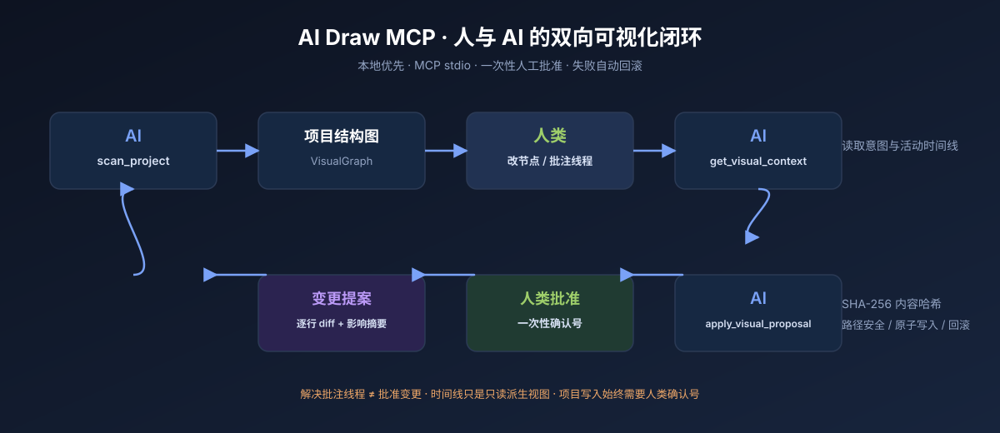
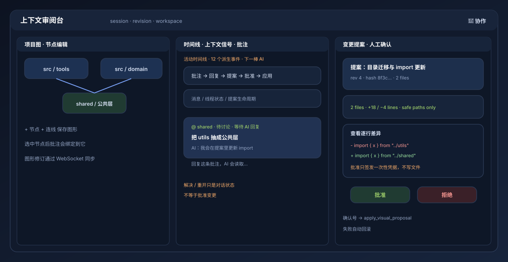

# AI Draw MCP (English Quickstart)

AI Draw MCP is a local-first MCP server and browser panel for **human ↔ AI visual collaboration**. An AI scans a project into an editable graph; a human edits nodes, replies in node-linked annotation threads, and discusses intent; the AI creates a reviewed file-change proposal; only after a human approves and passes back a one-time receipt can the AI apply the files.



The detailed Chinese README is [`README.md`](README.md). The full documentation map is [`docs/README.md`](docs/README.md).

## 30-second loop

```text
AI: scan_project → editable VisualGraph
Human: edit nodes / reply in annotation threads / send a message
AI: get_visual_context → intentByNode + annotationThreads.nextActor + staleThreads + activityTimeline
AI: create_visual_proposal → line-by-line diff + impact summary
Human: review diff → approve → copy the one-time receipt
AI: apply_visual_proposal(receipt) → safe write → automatic rollback on failure
```



## Install

```bash
npm install -g ai-draw-mcp
```

Configure an MCP stdio host with `npx ai-draw-mcp`, set `OUTPUT_DIR` to an absolute path, and set `AI_DRAW_WORKSPACE_ROOT` to the repository the AI should scan. Then open `http://127.0.0.1:3399/` and click `💬 协作`.

From source:

```bash
npm ci
npm run build
npm run doctor
node examples/collab-demo.mjs
```

If Chrome is outside Puppeteer's cache, set `PUPPETEER_EXECUTABLE_PATH`. CI and hardened Linux environments may also need `MERMAID_CHROME_NO_SANDBOX=1`.

## Safety model

- No account, no cloud service, and no public network binding by default.
- Proposal approval is a human panel action; it does not write files.
- `apply_visual_proposal` requires a one-time receipt bound to a SHA-256 content hash.
- Protected paths, binary writes, deletes, path escapes, and workspace-root writes are rejected.
- Atomic UTF-8 writes roll back on partial failure.
- Session bundles omit approval grants and require explicit human confirmation to import.
- Stale annotation threads are explicitly `outdated` or `detached`; AI must ask a human to review or re-anchor them before treating old discussion as current intent.

See [`SECURITY.md`](SECURITY.md), [`docs/ARCHITECTURE.md`](docs/ARCHITECTURE.md), and [`docs/TROUBLESHOOTING.md`](docs/TROUBLESHOOTING.md).

## Open-source project

MIT licensed. Contributions, roadmap feedback, and reproducible bug reports are welcome via [`CONTRIBUTING.md`](CONTRIBUTING.md), [`ROADMAP.md`](ROADMAP.md), and the issue templates. Public launch copy is versioned in [`docs/LAUNCH_KIT.md`](docs/LAUNCH_KIT.md); product research is in [`docs/COMPETITIVE_RESEARCH.md`](docs/COMPETITIVE_RESEARCH.md).
