# AI Draw MCP

> 给 IDE 里的 AI 一套可直接调用的可视化上下文工具 — AI 把项目理解成可编辑结构图，人只做轻量纠错、审阅与批准；项目变更始终由 AI 凭人工凭据执行。

AI 通过 MCP stdio 直接调用 26 个工具：扫描项目、生成 Mermaid/SVG、读取版本化 `VisualGraph`、焦点/多选、源码证据、只读投影与变更提案。**主入口是 AI，浏览器面板只是薄辅助层**：让人看一眼 AI 的理解，改图或补充节点级信号，必要时审阅完整 diff 并授权写入。

这不是聊天/协作应用，也不是托管白板。消息、批注与活动时间线只作为 AI 可读取的上下文信号存在，不构成「下一棒」或必须走完的对话流程；**只有人类审阅逐行 diff、批准并交给 AI 一次性确认号后，项目文件才会改变**。

> **30 秒阅读**：[快速开始](#快速开始) · [工具列表](#工具列表) · [安全模型与完整文档](docs/ARCHITECTURE.md)。仓库当前源码与 GitHub Release 为 `0.3.4`；npm `ai-draw-mcp` 仍为 `0.2.0`，体验当前版本请优先从源码安装，详见下方版本说明。

<p align="center">
  <a href="https://www.npmjs.com/package/ai-draw-mcp">
    
  </a>
  <a href="https://www.npmjs.com/package/ai-draw-mcp">
    
  </a>
  <a href="https://github.com/2648782102/ai-draw-mcp">
    
  </a>
</p>

---

## 预览

### 双向协作闭环

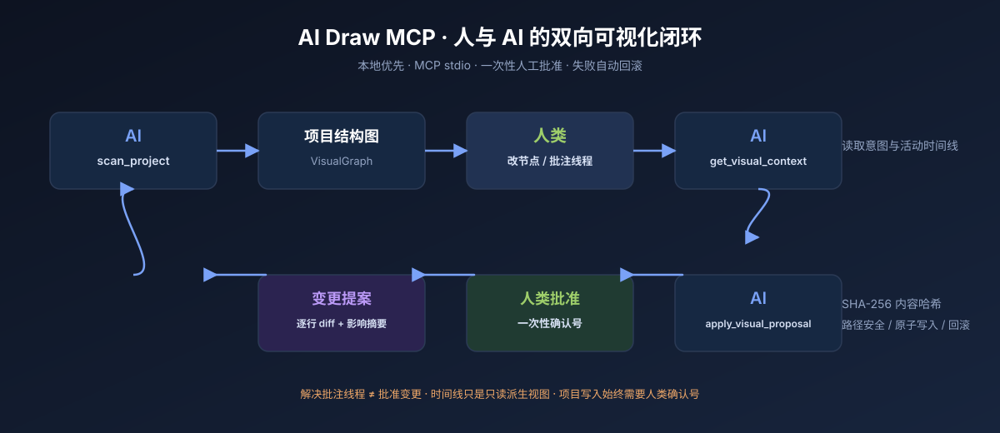

### 上下文审阅台概念

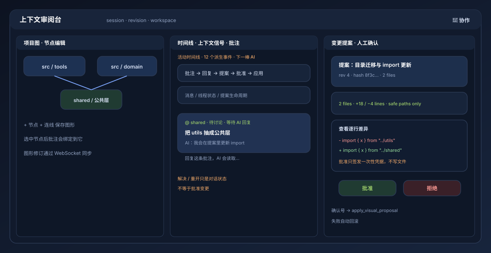

> 概念图由 [`scripts/generate-doc-assets.mjs`](scripts/generate-doc-assets.mjs) 可复现生成；要改文案或布局，请改脚本并运行 `npm run docs:assets`。

### 实际预览面板

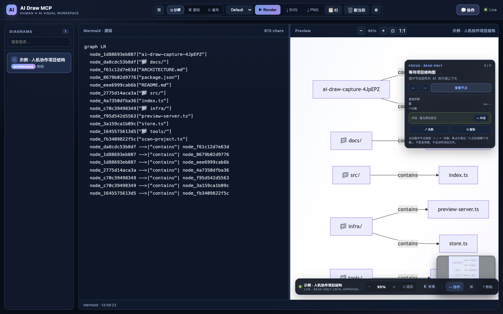

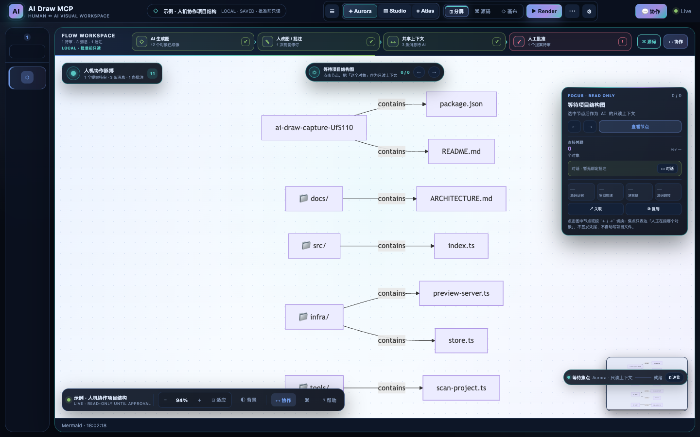

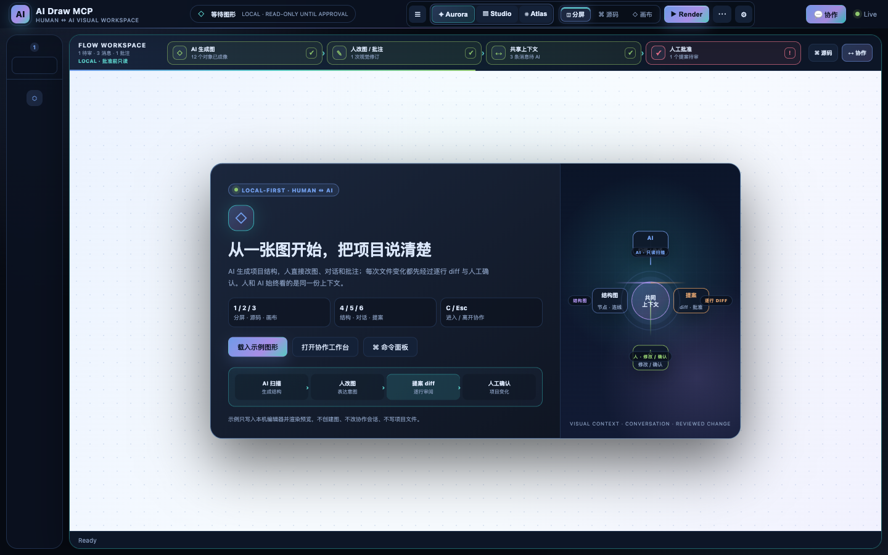

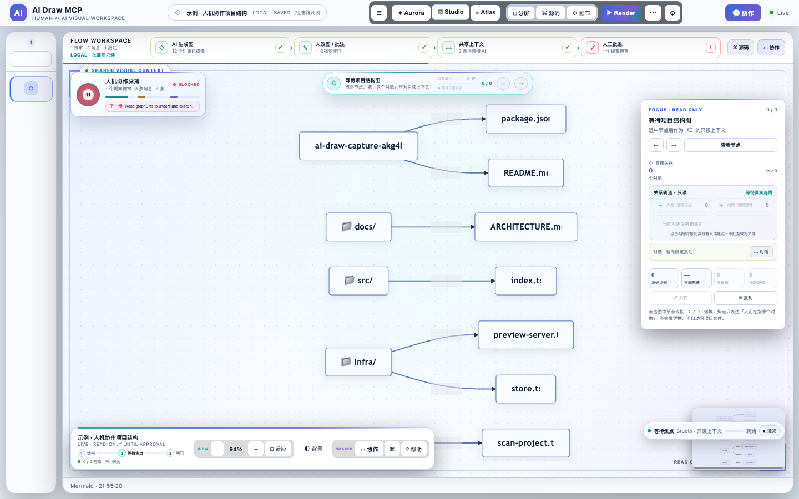

默认 Flow 视图把 AI 生成的结构化上下文放在主画布：图表库收成窄图标轨，顶部四步状态带只说明「MCP 扫描 → 人轻量纠错 → AI 读取上下文 → 人工批准」，状态均从既有只读会话派生。首用卡解释 AI 工具链、轻量纠错与写入闸门；既有消息、批注与活动记录仅作为可查看的上下文信号，不构成聊天发送或下一棒流程。画布、图形皮肤、焦点镜头、对象速览、源码抽屉和视觉偏好都只是本机呈现层，不改 Mermaid/SVG 导出、会话快照、批准凭据或项目文件。

界面提供 Aurora / Studio / Atlas 三套视觉系统，只影响本机 CSS 与布局偏好；`V`、`B`、`G`、`P`、`E`、`I`、`Z` 等快捷键用于查看结构化上下文、切换视图、复制只读投影或进入沉浸模式。左上角「上下文信号仪表」、焦点镜头、对象速览与底部操作条只读派生自既有会话、图数据、批注与诊断，用于降低人纠错与审阅 diff 的摩擦；它们不发送消息、不批准提案、不签发凭据，也不写项目文件。批准按钮仍只在完整逐行 diff 与影响摘要可见后启用，且必须人工确认。

画布背景叠加了随浅色/深色主题变化的柔和线性渐变，缩放与平移使用轻量过渡；切换焦点时当前节点会出现一次点选涟漪，并保留静态紫色光晕。系统开启「减少动态效果」时，面板会自动停用这些动画，不影响焦点、视口或协作语义。

顶部可在「分屏 / 源码 / 画布」之间切换（`1` / `2` / `3`），视图偏好会保存在本机；⚙ 外观面板集中控制 Classic / Flow 布局、Aurora / Studio / Atlas 视觉系统、浅色/深色主题、舒适/紧凑密度、预览背景、图表库显示、节点悬停速览与快捷键表。按 `?`、点击「⌘ 命令」或「⋯」菜单打开可搜索命令面板，`↑ / ↓ + Enter` 执行视图、上下文、外观与示例动作；按 `B` 切换布局、`V` 循环切换视觉系统、`G` 切换图形皮肤、`P` 显示 / 隐藏节点悬停速览、`E` 展开 Flow 源码抽屉、`I` 展开上下文速览。上下文审阅台支持 `C` 打开、`Esc` 关闭、`4` / `5` / `6` 切换项目图 / 上下文信号 / 提案，并在窄屏自动变成标签页。

按 `Z`、点击外观面板的「沉浸 · Z」或在命令面板搜索「沉浸」，会让顶栏、图表库、面板标题与状态栏退场，只保留图形、浮动操作条、对象焦点卡与一个可点击的退出徽标；`Z` / `Esc` / 退出徽标都能恢复完整工作区。Flow 布局下，操作反馈（包括沉浸态）始终移到画布操作条上方居中，不遮挡顶部四步协作流程带或缩放 / 协作按钮。当前只读焦点会用紫色真实 Mermaid 边常亮自己的直接关系路径，右侧关联统计同步显示「◆」；顶部焦点镜头新增「关系脉冲」把真实边数、全图边占比与入向数量画成微型进度带，对象卡还新增入向 / 出向关系轨道，直接把真实边数、方向与相邻对象铺开，点击相邻对象同步既有只读焦点；节点悬停速览还会叠加青色关系路径，并在速览卡里报告点亮的边数。它们只派生自既有 `collabGraph.edges` 的本机 DOM/CSS 视图，不改写图数据、导出的 SVG、会话状态或写入闸门。窄屏与触屏改用「轻点先速览、再点同一对象才设为只读焦点」的两段式交互，速览卡贴到画布底部并压缩信息密度，关系轨道与镜头脉冲也会收紧，焦点镜头与手势提示分层避让，避免遮挡缩放 / 协作按钮。视觉系统、沉浸模式与上下文速览只改本机布局、CSS 与派生视图，不改变焦点、视口、协作会话、批准凭据或项目写入闸门；偏好保存在本机 localStorage，系统要求「减少动态效果」时过渡会自动收敛，要求「更高对比度」时会增强边框与辅助文字。画布覆盖层在缩放 / 平移的过渡窗口内持续按帧同步、先应用悬停类，让焦点环、讨论徽标与速览卡持续跟随真实节点，避免较慢的 CI runner 读到中途位置。

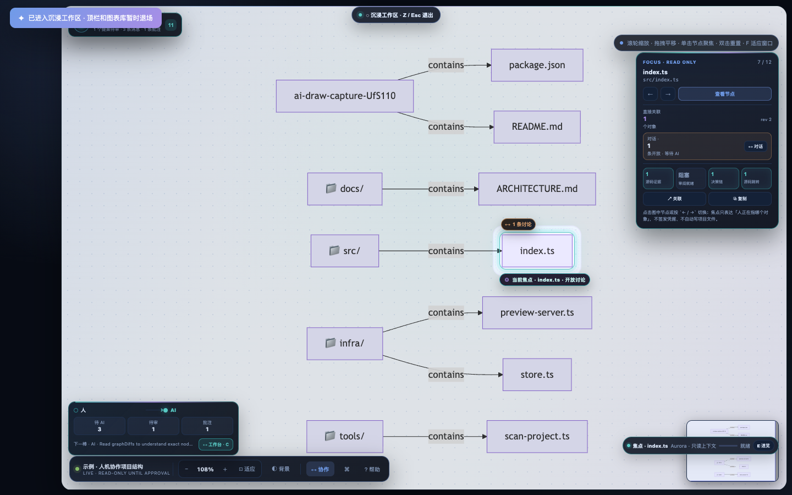

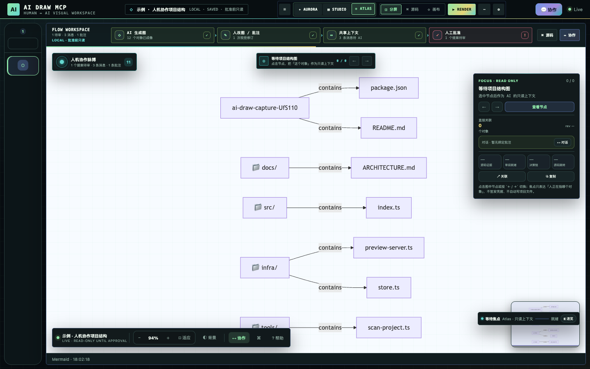

Atlas 截图同样由 `npm run ui:shots` 在临时示例会话中可复现生成；三套视觉系统只改本机 CSS 与布局，不改变 MCP 工具、协作协议、焦点/视口语义、批准凭据或项目写入闸门。

首用卡新增「AI 扫描 → 人改图 → 提案 diff → 人工确认」四步闭环条，当前会话有待审提案时自动高亮对应阶段；它只读取既有只读状态，不提前创建提案或授权写入。沉浸工作区截图同样由 `npm run ui:shots` 在临时示例会话中可复现生成；它只展示本机视图偏好，不代表服务绑定到公网、会话结构变化或文件被自动写入。

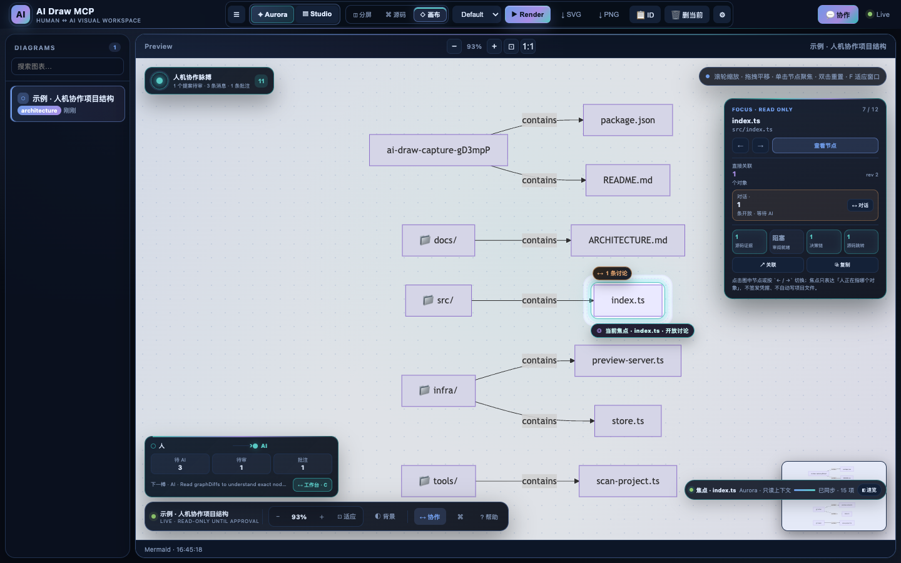

画布工作区截图由 `npm run ui:shots` 使用临时示例项目可复现生成：AI 扫描出的目录与文件成为结构化上下文，人在本机视图里选中对象、查看证据、审阅 diff 或批准提案。Aurora 光场、焦点胶囊、信号仪表和底部操作条只是本机 CSS/DOM 呈现层，不修改 Mermaid 输出、会话快照、`focus` / `viewport`、批准凭据或项目文件。截图里的示例节点、历史消息和提案只存在于临时会话，不代表仓库文件被自动修改。

画布右上角的「对象焦点」卡显示当前节点名称、序号、路径、图修订、直接关联对象数、入向 / 出向关系轨道与绑定批注信号；关系轨道与节点徽标只投影真实图数据和既有线程状态。点击短条、徽标或「查看上下文」只切换本机只读焦点与面板视图；「复制」生成不含凭据或绝对路径的只读提示。当前节点随缩放/平移实时跟随，焦点上下文胶囊悬停展示真实边数、开放讨论与源码证据；这些操作不发布聊天、不签发凭据、不创建提案或写项目文件。

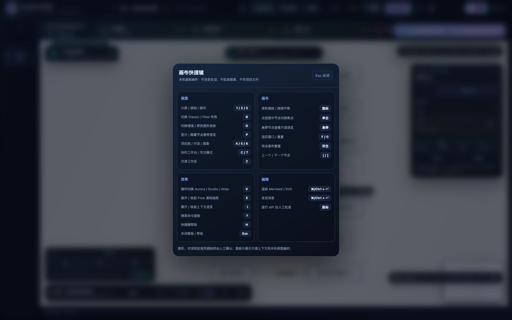

按 `H`、点击浮动条的「? 帮助」或在命令面板搜索「快捷键」，会打开本机快捷键卡片：把视图切换、画布手势、命令/帮助入口与编辑动作按场景分组，并明确「只读上下文 + 人工确认」边界；`Esc` 或点击卡片外部关闭。画布手势提示也移到右上角，避免与浮动操作条争夺底部空间。

### 上下文审阅台

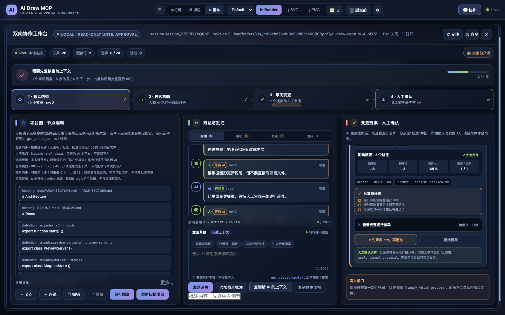

上下文审阅台把「项目图 / 上下文信号 / 变更提案」分成三张信息卡：项目图供人轻量纠错，上下文卡只读展示历史消息、批注、差异与投影，提案卡集中呈现路径、影响摘要、完整逐行 diff 和人工批准。纠错草稿只复制到剪贴板交给 AI，不写入会话、不发送消息；面板不提供聊天线程回复。批准后会弹出一次性确认号卡片，四个凭据字段可逐项阅读或一键完整复制，并明确仍需交给 AI 调用 `apply_visual_proposal`；它不替用户调用工具，也不自动写项目文件。展开 diff 会显示加载中 / 已加载 / 加载失败状态，批准按钮从「先审阅 diff」温和切换为「批准并签发确认号」；进度到 100% 只代表材料已核对，不会自动批准或写文件。后台同步按提案签名复用 DOM，并在指针交互期间延后重绘，避免正在点击的审批按钮被刷新替换。截图由 `npm run ui:shots` 使用临时会话示例可复现生成，不代表仓库文件被自动修改。

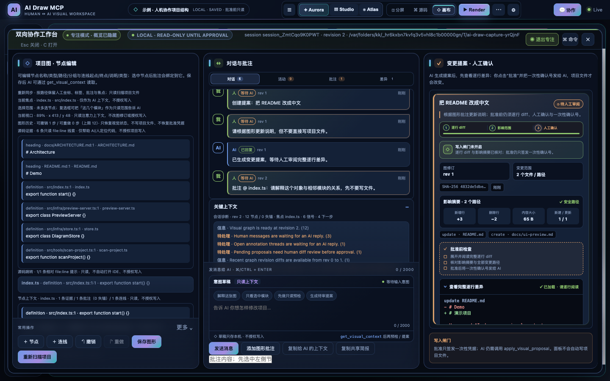

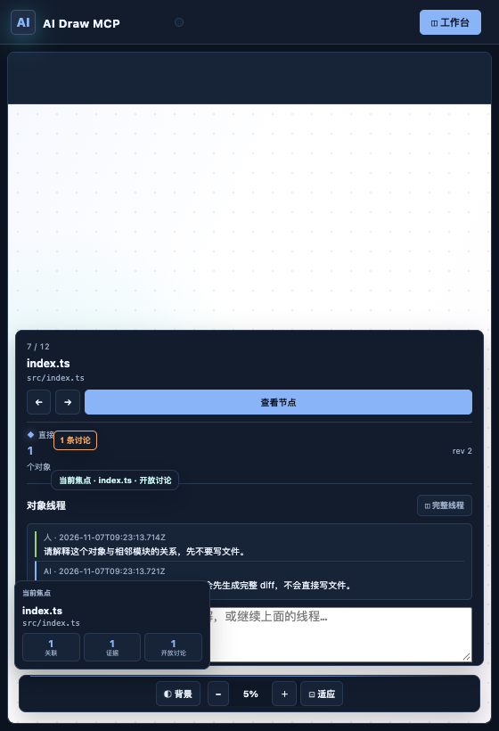

点击「◎ 专注」、按 `7` 或在命令面板搜索「专注」，会暂时隐藏概览统计、健康卡和流程条，把三栏内容放大；偏好保存在本机，`7` 或顶栏按钮可随时恢复。专注模式只改本机布局，不改变会话、提案状态或写入闸门。

---

## 功能

- **26 个 MCP 工具** — 原有 11 个绘图/管理工具，加上 `scan_project`、`get_capabilities`、`get_selection_scope`、`get_selection_workorder`、`get_visual_context`、`get_shared_brief`、`get_decision_trail`、`get_node_context`、`get_source_navigation`、`get_agent_workflow`、`reply_to_visual_context`、`preflight_visual_proposal`、`list_change_templates`、`create_visual_proposal`、`apply_visual_proposal`
- **上下文审阅台** — 项目结构扫描、节点/连线的轻量纠错、绑定批注信号、只读上下文投影、逐行 diff 审阅与提案批准；不提供聊天发送，WebSocket 实时同步给 AI 和面板
- **有界图形撤销 / 重做** — 12 步视觉状态历史，人类确认后恢复节点/连线/批注为一次新图形修订；不回退项目文件、提案状态或一次性批准凭据
- **只读源码证据** — 扫描时为源码/文档节点记录少量 `file:line` 定义、导入或标题线索，AI 与面板可引用代码位置；证据不自动改代码、不扩大提案路径，也不签发批准凭据
- **有界多选范围** — 面板复选框最多选择 24 个节点；`get_selection_scope` 与 `SELECTION_SCOPE_JSON` 把「这几个模块」投影成节点、内部连线和安全相对 `file:line` 证据。选择范围只表达意图，不签发凭据、不改变图修订或授权项目写入，详见 [ADR 0018](docs/ADR/0018-human-selection-is-read-only-scope.md)
- **只读预提案工作单** — `get_selection_workorder` 与 `SELECTION_WORKORDER_JSON` 把选中范围、候选路径、范围内意图、证据、审阅缺口和下一步收束成可复制清单；纯派生 `freshness` 在图修订变化后提示重新选择，但不自动刷新/清空选择。不含文件内容/逐行 diff/提案/凭据，仍需预检、人工审阅完整 diff 与一次性确认号，详见 [ADR 0019](docs/ADR/0019-selection-workorder-is-read-only-preflight.md)
- **可复制源码跳转** — `get_source_navigation` 与面板「复制源码跳转」返回 version 1 `SOURCE_NAVIGATION_JSON`：有界、工作区相对 `file:line`、`vscode://` / `cursor://` URI 文本和 `code --goto` 提示；只复制，不打开文件、启动 IDE、执行命令或授权项目写入，详见 [ADR 0016](docs/ADR/0016-source-navigation-is-copyable-context.md)
- **单节点上下文** — `get_node_context` 把焦点节点的源码证据、批注线程、入/出连线、相关图形差异与焦点聚合成 version 1 只读投影；面板显示同一视图，AI 不必从完整会话里手工拼装
- **共享简报** — `get_shared_brief` 与面板「复制共享简报」使用同一份 version 1 `BRIEF_JSON`：紧凑列出焦点、就绪阻塞、待处理意图、失锚讨论、最近图形修订、源码证据和下一步；不含批准凭据，也不授权写入
- **可审计决策链** — `get_decision_trail` 与面板「复制决策链」使用同一份 version 1 `DECISION_TRAIL_JSON`：把人的意图、有效/失锚批注、字段级图修订、提案变更摘要、批准/应用状态与时间线按证据类型串联；提案变更行只是有界投影，批准仍需查看完整逐行 diff，输出永不含确认号
- **人类视口注意力** — 面板的缩放/平移状态以有限值只读同步给 AI，帮助它判断人正在看整张图还是某个区域；不产生图修订、对话事件、差异或批准凭据
- **人工确认的安全变更** — 面板批准只生成一次性凭据；AI 凭凭据应用提案，拒绝危险路径，写入失败自动回滚
- **可复核导出清单** — 面板导出会话 bundle 时附带 version 1 `EXPORT_MANIFEST_JSON`：列出资产计数、建议文件名、被排除的一次性凭据/图形历史/视口与只读安全标记；导入仍严格校验原 `session`，清单不授权写入
- **审阅就绪诊断** — `REVIEW_READINESS_JSON` 把共享简报阻塞与决策链证据缺口汇总成 `ready` / `review` / `blocked`；诊断、面板与工作流示例共用同一只读投影，不签发凭据、不替代逐行 diff
- **实时双向面板** — AI 绘图后通过 WebSocket 推送到面板；面板里也可手动编辑源码、实时预览、保存回磁盘
- **双模式编辑器** — Mermaid DSL 模式 / SVG 全文本模式（`render_svg` 生成的图自动切换到 SVG 模式）
- **小地图导航** — 右下角缩略图，支持点击/拖拽直接跳转视口
- **流畅缩放平移** — 滚轮缩放（以鼠标为锚点）、左键拖拽平移、不卡顿不模糊（纯矢量渲染）
- **离线 Mermaid** — 面板从本包 `node_modules/mermaid/dist` 加载，不依赖 CDN
- **SVG & PNG 输出** — 渲染结果同时落盘为 `.svg`；配置 `DEFAULT_FORMAT=png` 或工具参数 `output_format: png` 也输出 PNG（Mermaid 走 mmdc，SVG 走 sharp）

---

## 文档

| 文档 | 内容 |
|------|------|
| [README.en.md](README.en.md) | English quickstart：最短安装、协作闭环与安全边界 |
| [docs/ARCHITECTURE.md](docs/ARCHITECTURE.md) | 架构、状态模型、活动时间线、REST/WebSocket 协议、安全边界 |
| [docs/README.md](docs/README.md) | 文档地图：按读者与用途查找全部资料 |
| [docs/TROUBLESHOOTING.md](docs/TROUBLESHOOTING.md) | 首用自检、常见故障与 FAQ（含一次性确认号失效） |
| [docs/TROUBLESHOOTING.md](docs/TROUBLESHOOTING.md#多选后重新扫描工作单显示-stale-怎么办what-does-a-stale-selection-workorder-mean) | 30 秒 FAQ：重新扫描后的 stale 多选工作单该怎么处理 |
| [ROADMAP.md](ROADMAP.md) | 产品方向、阶段目标与明确的非目标 |
| [docs/COMPETITIVE_RESEARCH.md](docs/COMPETITIVE_RESEARCH.md) | Mermaid/白板/MCP 同类产品调研与定位 |
| [docs/DEPENDENCY_MAINTENANCE.md](docs/DEPENDENCY_MAINTENANCE.md) | 依赖升级与 CI 维护策略 |
| [docs/LAUNCH_KIT.md](docs/LAUNCH_KIT.md) | GitHub About、Release notes、Show HN 与社区宣发模板 |
| [docs/GOVERNANCE.md](docs/GOVERNANCE.md) | 开源治理、公开入口、维护检查与元数据漂移证据 |
| [docs/GOAL_MODE.md](docs/GOAL_MODE.md) | 目标模式：如何给 AI 设自治目标、时间边界、安全红线与验收证据 |
| [docs/ADR/README.md](docs/ADR/README.md) | 架构决策记录：人工批准、对话状态、失锚线程与只读预检 |
| [AGENTS.md](AGENTS.md) | AI coding agent 操作手册 |
| [CONTRIBUTING.md](CONTRIBUTING.md) | 开发、验证与 PR 约定 |
| [SECURITY.md](SECURITY.md) | 威胁模型、支持版本与漏洞报告 |
| [CHANGELOG.md](CHANGELOG.md) | 变更记录 |
| [VERSIONING.md](VERSIONING.md) / [RELEASING.md](RELEASING.md) | 版本与发布策略 |
| [examples/](examples/README.md) | MCP 配置、Mermaid/SVG、端到端协作演示 |

> 本项目不是托管白板，也不是「AI 自动改代码」按钮；它是本地优先、需要人类审阅与一次性批准的可视化协作协议。非目标与未来方向见 [ROADMAP.md](ROADMAP.md)。

---

## 双向协作流程

```text
AI: scan_project → 生成项目结构图
人: 可选在「⌁ 审阅台」里改名 / 添加批注信号 / 复制纠错上下文
AI: get_agent_workflow → 读取八步顺序契约与 blocked 就绪提示
AI: get_visual_context → 理解意图与活动时间线
AI: reply_to_visual_context → 在面板里回信、回复节点批注线程并标记已处理
AI: list_change_templates → 可选：把常见意图展开成只读候选草稿
AI: preflight_visual_proposal → 只读检查路径/文件状态/重复内容
AI: create_visual_proposal → 生成变更提案
人: 查看逐行差异并点击「批准」→ 复制一次性确认号
AI: apply_visual_proposal(确认号) → 安全写入工作区 → 失败自动回滚
AI: 再次 scan_project → 保留人工布局/批注/焦点并让图与代码保持一致
```

> 示例：AI 根据项目结构画出现有模块；人在图上把 `utils` 改名为 `shared` 并批注「抽成公共层」，随后可在同一线程继续追问或重开讨论；AI 读取修订与 `annotationThreads.nextActor` 后提出目录迁移与 import 更新提案；人批准后项目真正变化。

> **节点批注线程**：每个批注形成独立线程，保存根批注、人与 AI 的有序回复、解决/重开状态、关联节点标签/路径与图形修订。节点改名或路径变化会标记为 `outdated`，节点删除会标记为 `detached`；`get_visual_context.staleThreads` 会提醒 AI 不要把旧讨论当成当前意图。过期线程可由人确认重锚，失锚线程保留原 `nodeId` 供审计。解决线程只是对话状态，**不等于批准变更**；项目文件仍须由人查看逐行 diff、批准并提供一次性确认号。

> **紧凑活动时间线**：面板和 `get_visual_context.activityTimeline` 把消息、图形修订、节点批注回复、线程状态、提案创建与批准/应用/拒绝按时间合并成只读派生事件，帮助人和 AI 快速回顾「刚刚发生了什么」。时间线不替代原文、不签发批准凭据，也不授权项目写入。

> **只读会话诊断**：面板、`/api/collab/diagnostics` 与 `get_visual_context.diagnostics` 汇总图/线程/提案状态、图形修订差异、待处理信号、下一步动作和安全不变量，帮助人和 AI 快速判断「现在该谁做什么」。诊断不写会话、不签发凭据、不授权项目写入。

> **只读决策链**：`get_decision_trail`、`GET /api/collab/decision-trail` 与面板「复制决策链」返回同一份 version 1 `DECISION_TRAIL_JSON`：按时间把待处理消息、有效批注线程、失锚讨论、字段级图修订、提案变更摘要、批准/应用阶段和活动时间线串联起来，帮助人和 AI 复盘「为什么做这个改动」。失锚讨论只作为历史证据，提案变更行是有界投影而非完整逐行 diff，输出不含确认号、不持久化、不改会话、不批准变更、不授权项目写入；详见 [ADR 0013](docs/ADR/0013-decision-trail-is-a-read-only-projection.md)。

> **可复核导出清单**：`GET /api/collab/bundle/manifest` 与面板下载的 `exportManifest` 返回从同一会话 bundle 派生的 version 1 `EXPORT_MANIFEST_JSON`：列出格式/版本、建议文件名、图/批注/证据/消息/提案计数、已降级的批准状态，以及刻意排除的一次性批准凭据、图形历史和视口。清单是只读清单，不持久化、不充当导入真源、不签发凭据、不批准变更、不写项目文件；详见 [ADR 0014](docs/ADR/0014-export-manifest-is-a-derived-inventory.md)。

> **审阅就绪诊断**：`GET /api/collab/review-readiness`、`CONTEXT_JSON.diagnostics.reviewReadiness` 与面板「审阅就绪」返回同一份 version 1 `REVIEW_READINESS_JSON`：把 `BRIEF_JSON` 的就绪阻塞和 `DECISION_TRAIL_JSON` 的证据缺口汇总为 `ready` / `review` / `blocked`，并给出对应的诊断信号与下一步提示。它是派生只读投影，不批准变更、不签发凭据、不写会话或项目文件；工作流示例实际读取它，批准前仍须查看完整逐行 diff。详见 [ADR 0015](docs/ADR/0015-review-readiness-is-a-derived-diagnostic.md)。

> **只读源码跳转**：`get_source_navigation`、`GET /api/collab/source-navigation` 与面板「复制源码跳转」返回同一份 version 1 `SOURCE_NAVIGATION_JSON`：把已有 `GraphSourceEvidence` 投影成有界的相对 `file:line` 清单、编辑器 URI 文本和命令行提示。它过滤绝对路径、目录穿越、受保护目录与 `.env`-like 名称，不重复读项目文件、不打开文件、不启动 IDE/执行命令、不改会话/焦点/线程/提案、不进入 bundle、不签发凭据，也不授权项目写入；详见 [ADR 0016](docs/ADR/0016-source-navigation-is-copyable-context.md)。

> **当前焦点**：人在面板选中节点后，服务端会记录 version 1 `SessionFocus`，把节点 ID、当前标签/路径/分组与图形修订交给 `get_visual_context.focus`、诊断和会话 bundle。AI 能据此理解「这个模块」「这里」指的是哪个对象；节点删除后焦点自动清除。焦点只是注意力上下文，不签发批准凭据、不解决线程、不创建提案，也不授权项目写入。

> **复制给 AI 的上下文**：面板的「复制给 AI 的上下文」按钮会生成包含会话 ID、工作区、图形修订、当前焦点、最近图形差异的字段级摘要、诊断信号与下一步的只读提示，并明确要求 AI 先 `get_visual_context`、先预检、等人批准后再应用。按钮只复制到剪贴板或在不可用时放入本机纠错草稿框，不写会话、不发送消息、不签发确认号。

> **图形修订差异**：每次保存图形会记录字段级 `graphDiffs`（节点/连线增删、`label` / `kind` / `path` / `group` / 连线端点变化）；AI 通过 `get_visual_context.graphDiffs` 精确读取人改了哪张图，而不是从聊天文本猜测。面板可展开最近修订逐项查看字段前后值，活动时间线也会合并 `graph_diff` 派生事件。差异只是审计上下文，不自动生成或批准项目变更。

> **只读变更模板**：`list_change_templates` 列出「更新文档 / 添加测试 / 创建模块」三个常见意图，并可把它们展开成带路径、完整 UTF-8 内容、`graphRevision` 与引用节点的候选草稿。模板只生成文本，不创建提案、不写文件、不签发确认号；AI 仍需先 `preflight_visual_proposal`，再由 `create_visual_proposal` 交给人类审阅。

> **可复现 Agent 工作流**：`get_agent_workflow` 从当前会话派生 version 1 `WORKFLOW_JSON`：八步顺序、每步 `requires` / `produces` / `readOnly` / `writes` / `grantsWriteAuthority`、陈旧线程与人类回合的 `blocked` 提示，以及与诊断一致的紧凑 `reviewReadiness` 字段。它只是描述性契约，不创建提案、不写会话或项目文件、不签发确认号；`ready` 不跳过完整逐行 diff，唯一 `writes: "project"` 的步骤是 `apply_visual_proposal`，仍须人工批准与一次性确认号。只读示例见 [examples/agent-workflow.mjs](examples/agent-workflow.mjs)，设计边界见 [ADR 0007](docs/ADR/0007-agent-workflow-is-a-read-only-contract.md)。

> **重新扫描不丢人工状态**：扫描器按工作区相对路径生成确定性节点/连线 ID；`VisualSyncService` 与 `mergeScannedGraph()` 会按稳定 ID 或路径迁移人工坐标、自定义名称、批注线程与 `SessionFocus`，新增节点才自动排布，删掉的文件会让相关讨论显式 `detached`。AI 的 `scan_project` 返回 `PRESERVATION_JSON`；面板「重新扫描项目」要求本机令牌与 `confirmedBy: "human"`。两者都只读项目文件，图形同步不等于批准或写入，详见 [ADR 0006](docs/ADR/0006-stable-scan-preserves-human-visual-state.md)。

> **图形撤销不是代码撤销**：面板「↶ 撤销 / ↷ 重做」只切换有界 `VisualGraph` 快照，每次恢复都产生新 `graphRevision` 和字段级 `graphDiffs`，需要本机令牌与 `confirmedBy: "human"`。它不写工作区文件、不恢复/撤销已批准提案、不签发或复活一次性确认号；bundle 不携带历史。详见 [ADR 0008](docs/ADR/0008-visual-undo-is-not-project-undo.md)。

> **源码证据只是只读引用**：`scan_project` 对 1 MiB 以下的源码/Markdown 文本提取最多 5 条 version 1 `GraphSourceEvidence`（`definition` / `import` / `heading`），含工作区相对路径、正整数行号和 160 字摘要。`get_visual_context.sourceEvidence`、面板「源码证据」列表与 `GET /api/collab/source-evidence` 让 AI 和人从图追溯到 `file:line`；bundle 严格校验字段，证据不签发确认号、不扩大批准路径，也不授权写入。详见 [ADR 0009](docs/ADR/0009-source-evidence-is-read-only-context.md)。

详细架构与安全模型见 [docs/ARCHITECTURE.md](docs/ARCHITECTURE.md)，贡献方式见 [CONTRIBUTING.md](CONTRIBUTING.md)。

想在临时工作区里完整体验闭环，可运行：

```bash
npm run build
node examples/collab-demo.mjs
```

只查看 AI 应遵守的只读工作流（到 preflight 自动停止，不创建提案或写文件）：

```bash
npm run test:examples:workflow
```

---

## 快速开始

最短体验路径：从源码安装 → 在 IDE 配置 MCP → 让 AI 调用 `scan_project` → 在面板查看项目结构图与上下文 → 必要时审阅完整 diff 并授权写入。完整闭环可运行 `node examples/collab-demo.mjs`。

> **版本说明（2026-11-07）**：仓库源码与 GitHub Release 为 `0.3.4`，但 npm registry 的 `ai-draw-mcp` 仍是 `0.2.0`。`npm install -g ai-draw-mcp` 与 `npx ai-draw-mcp` 当前只会装到旧版本；想使用本仓库当前功能，请按「方式一：从源码安装」。等 npm 发布同步后，再恢复 npm / npx 安装路径。

### 方式一：从源码安装（体验当前 `0.3.4`）

```bash
git clone https://github.com/2648782102/ai-draw-mcp.git
cd ai-draw-mcp
npm ci
npm run build
```

可选自检（验证 Node 版本、mmdc、端口、输出目录）：

```bash
npm run doctor
```

配置到 Cursor（或其他 IDE）：

```json
{
  "mcpServers": {
    "ai-draw": {
      "command": "node",
      "args": ["D:/path/to/ai-draw-mcp/dist/index.js"],
      "env": {
        "PREVIEW_PORT": "3399",
        "OUTPUT_DIR": "D:/path/to/output"
      }
    }
  }
}
```

> 将 `args[0]` 和 `OUTPUT_DIR` 替换为你本机的**绝对路径**。Windows 路径用正斜杠或双反斜杠均可。

### 方式二：通过 npm 安装（仅旧版 `0.2.0`）

```bash
npm install -g ai-draw-mcp
```

然后直接在 MCP 配置里使用：

```json
{
  "mcpServers": {
    "ai-draw": {
      "command": "npx",
      "args": ["ai-draw-mcp"],
      "env": {
        "OUTPUT_DIR": "./output"
      }
    }
  }
}
```

> 这一路径对应 npm 已发布的 `0.2.0`，不代表仓库当前的 `0.3.4` 功能集。任何使用 `npx ai-draw-mcp` 的旧配置同样只适用于 `0.2.0`，直到 npm 发布同步。

---

## 工具列表

> 当前版本 `0.3.4` 共 26 个工具；工具名与数量同步受 `src/server.ts` 的 `TOOL_COUNT`、`SERVER_TOOL_COUNT`、离线检查与 MCP 测试保护。

| 工具 | 用途 |
|------|------|
| `render_diagram` | 任意 Mermaid DSL 直接渲染 |
| `render_flowchart` | 流程图（自动生成 `flowchart TD` DSL）|
| `render_sequence` | 时序图（自动生成 `sequenceDiagram` DSL）|
| `render_architecture` | 架构 / 组件图（`graph TB` + `subgraph` DSL）|
| `render_class_diagram` | UML 类图（`classDiagram` DSL）|
| `render_mindmap` | 思维导图（`mindmap` DSL）|
| `render_svg` | 自由 SVG — 直接传入 SVG 源码，面板进入 SVG 编辑模式 |
| `update_diagram` | 按 ID 更新已有图（重新渲染 + 推送） |
| `delete_diagram` | 按 ID 删除磁盘文件 + 通知面板 |
| `list_diagrams` | 列出全部已生成图表（含 ID、类型、路径） |
| `open_preview` | 在 IDE 中打开预览面板，可 deep-link 到指定图 |
| `scan_project` | 只读扫描工作区，生成/刷新项目结构图；稳定路径 ID 保留人工布局、批注与焦点，返回 `PRESERVATION_JSON`；`render: false` 可供无头状态检查 |
| `get_capabilities` | 一次读取 `CAPABILITIES_JSON`：全部工具、JSON 契约、工作流/审阅就绪、下一步安全动作与唯一项目写入边界；只读，不调用其他工具、不签发凭据 |
| `get_selection_workorder` | 读取 `SELECTION_WORKORDER_JSON`：把有界选择范围收束为只读预提案工作单，含选择新鲜度提示；不含文件内容/逐行 diff/提案/凭据，不授权写入 |
| `get_selection_scope` | 读取 `SELECTION_SCOPE_JSON`：有界多选节点、范围内内部连线、安全相对 `file:line` 证据与焦点包含状态；只读，不改选择、不授权写入 |
| `get_selection_workorder` | 读取 `SELECTION_WORKORDER_JSON`：有界选中范围、安全相对候选路径、范围内意图、`file:line` 证据、选择新鲜度、审阅缺口与下一步；只读，不含文件内容/逐行 diff/提案/凭据 |
| `get_visual_context` | 读取图形修订、批注线程、对话、意图摘要与 `activityTimeline`，供 AI 修改代码前理解上下文 |
| `get_agent_workflow` | 读取当前会话的八步 `WORKFLOW_JSON`、前后条件、就绪阻塞与写入边界；只读，不签发凭据或授权写入 |
| `get_shared_brief` | 读取紧凑 `BRIEF_JSON` 交接视图：状态、焦点、阻塞、有效/失锚意图、最近修订、证据与下一步；只读，不含批准凭据 |
| `get_decision_trail` | 读取 `DECISION_TRAIL_JSON` 只读决策链：意图 → 图形修订 → 有界提案变更摘要 → 批准/应用状态；不含确认号，不替代完整逐行 diff |
| `get_node_context` | 读取单个节点的 `NODE_CONTEXT_JSON`：源码证据、批注线程、相邻连线、相关图形差异与焦点；默认取人类选中节点，只读 |
| `get_source_navigation` | 读取 `SOURCE_NAVIGATION_JSON` 只读源码跳转清单：有界相对 `file:line`、可复制 VS Code/Cursor URI 与 CLI 文本；不打开文件、不启动 IDE、不执行命令、不授权写入 |
| `reply_to_visual_context` | AI 在面板里回复人类、回复节点批注线程，并可把消息/批注标记为已回答、已解决 |
| `create_visual_proposal` | 创建待确认的项目变更提案，不直接写项目文件 |
| `preflight_visual_proposal` | 创建提案前只读检查候选变更的路径、文件状态、重复内容与阻断项 |
| `list_change_templates` | 列出或展开常用变更模板草稿；只读，不创建提案、不写文件、不签发确认号 |
| `apply_visual_proposal` | 应用经人类批准的提案；拒绝危险路径，失败自动回滚 |

---

## 环境变量

| 变量 | 默认值 | 说明 |
|------|--------|------|
| `PREVIEW_PORT` | `3399` | 预览服务端口 |
| `PREVIEW_HOST` | `127.0.0.1` | 面板地址主机名 |
| `OUTPUT_DIR` | `./output` | 图表输出目录（**建议绝对路径**） |
| `DEFAULT_THEME` | `default` | Mermaid 主题：`default` / `dark` / `forest` / `neutral` |
| `DEFAULT_FORMAT` | `svg` | 默认输出格式：`svg` / `png` |
| `LOG_LEVEL` | `info` | 日志级别：`debug` / `info` / `warn` / `error` |
| `AI_DRAW_WORKSPACE_ROOT` | 包根目录 | 协作扫描与提案应用的目标工作区；MCP 宿主应设为当前项目根目录 |
| `PUPPETEER_EXECUTABLE_PATH` | 自动检测 | 本机 Chrome/Chromium 路径，用于 `mmdc` 在没有缓存浏览器时渲染 |

---

## 面板快捷操作

| 操作 | 效果 |
|---|---|
| 滚轮 | 以鼠标为中心缩放 |
| 左键拖拽 | 平移画布 |
| 双击画布 | 重置为 1:1 |
| `F` 键 | 适应窗口 |
| `0` 键 | 重置为 100% |
| `⊡` 按钮 | 适应窗口 |
| 右下角小地图 | 点击/拖拽跳转视口 |
| `Ctrl+Enter` | 手动触发重新渲染 |
| `Ctrl+S` | 保存当前编辑到磁盘 |
| `⌁ 审阅台` | 打开薄辅助面板：纠错图/批注信号、复制上下文、审阅 diff、批准提案 |

---

## 故障排除

完整首用清单、端口/Chrome/扫描根目录/批注线程/一次性凭据 FAQ 见 [docs/TROUBLESHOOTING.md](docs/TROUBLESHOOTING.md)。

**端口被占用**：改 `PREVIEW_PORT`，例如 `3400`。

**`mmdc` 渲染失败**：执行 `npm run doctor` 自检；Windows 下需要 Puppeteer 能拉起 Chromium。

**面板空白 / JS 报错**：重启 MCP（Cursor 设置里把 `ai-draw` 关掉再开启），再刷新面板页。

**上下文审阅台没有图**：让 AI 调用 `scan_project`，或检查 `AI_DRAW_WORKSPACE_ROOT` 是否指向正确项目。

**提案无法应用**：确认由人类点击批准；检查目标路径是否属于 `.git`、`node_modules`、`dist`、`.env*` 或锁文件等受保护范围。

**PNG 中文方块**：需系统有中文字体；或改用 `DEFAULT_FORMAT=svg` 避免 mmdc 栅格化。

**AI 过早抢答批注线程**：检查 `get_visual_context.annotationThreads.nextActor`；为 `human` 时应等待人继续回复，不要创建或应用提案。

**一次性确认号失效**：提案被改动、确认号已使用或已过期都会让旧凭据失效；重新查看逐行 diff，点击「批准」生成新的确认号，不要把旧确认号粘贴到 Issue 或会话 bundle。

---

## License

MIT
